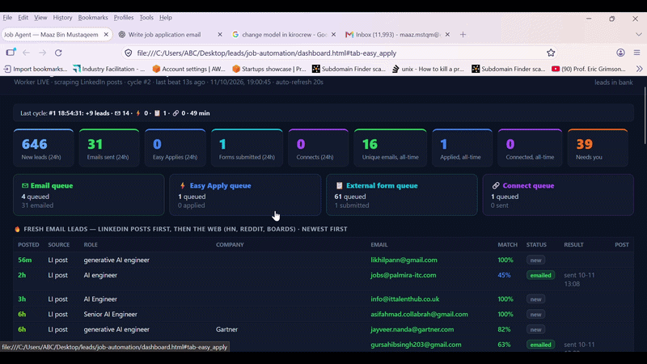

<div align="center">

# 🧭 JobPilot

### The self-evolving, agent-driven job hunter that lives in *your* browser.

**Bring your own AI coding agent as the brain. JobPilot is the hands, the memory, and the
nervous system — it applies for you across four channels, learns from every failure, and ships
its own fixes back to this repo.**

[](LICENSE)
[](https://modelcontextprotocol.io)
[](https://nodejs.org)
[](CONTRIBUTING.md)
[](#-the-self-evolution-loop)



<sub>▶️ Full-quality demo video: [`docs/demo.mp4`](docs/demo.mp4)</sub>

</div>

---

## 💡 What is this?

JobPilot is an [MCP](https://modelcontextprotocol.io) server with **no LLM of its own**. *Your*
coding agent — Claude Code, Codex, Kiro, Crew, Grok CLI — is the brain. You point it at JobPilot
and say *“find and apply to AI jobs.”*

The agent reasons. JobPilot provides:

- **🖐 Hands** — it drives *your* already-logged-in Chrome (LinkedIn, Gmail, ATS) over the DevTools protocol.
- **🧠 Memory** — a local dedup database so you never double-apply, across runs or agents.
- **🧬 A nervous system** — it records every failure, *learns from it*, and gets measurably better each session.

No API keys. No SMTP passwords. No scraping of other people's data. Your sessions, your machine, your data.

---

## ⚡ What it actually does — four channels, freshest-first

| Channel | What happens |
|---|---|
| ✉️ **Email** | Finds hiring emails in LinkedIn posts, HN "Who is hiring", Reddit & boards → sends a tailored email from **your Gmail**, CV auto-attached & verified. |
| ⚡ **LinkedIn Easy Apply** | Walks the multi-page modal, answers every question, uploads your CV, and **verifies "Application submitted."** |
| 📋 **External ATS forms** | Greenhouse · Lever · Ashby · Workable — resolves job-board links to the real ATS, fills react-selects / radios / consent, submits, confirms. |
| 🔗 **LinkedIn connect + note** | When there's no email/form, sends the poster a personalized connection request. |

Everything is ordered **newest-posted first** — because the first applicant gets read.

---

## 🧬 The self-evolution loop

This is what makes JobPilot different from every other job bot.

Every time it hits something it can't handle — a weird Easy Apply question, a form with no submit
button, a login-gated ATS — it records an **encounter**: a normalized signature, a running count,
and a saved **screenshot + HTML snapshot** under `data/evolution/`. Then it:

1. **🪄 Harvests** the answers you've *already* filled on LinkedIn (your real years-of-experience,
   salary, work-authorization) and reuses them everywhere.
2. **🙋 Asks you once.** Anything it genuinely can't infer becomes a *“question for you”* in the
   dashboard — answer it one time, remembered forever (fuzzy-matched across all future applications).
3. **📈 Reweights itself.** It tracks which search queries and ATS domains actually convert and
   shifts toward what works (UCB bandit), auto-skipping dead ends.
4. **🔁 Contributes back (on by default).** It files GitHub issues for blockers it discovers and
   pushes code/doc improvements to this repo — **attributed to you, hard-guarded so it never
   touches your data.** Toggle it off anytime from the dashboard.

> Your coding agent reads the auto-generated `data/evolution/PLAYBOOK.md`, patches the relevant
> module, marks the encounter fixed — and the fix is pushed back for everyone. **The repository
> literally improves itself, session over session.**

---

## 🏆 What's been achieved

- **All four channels working end-to-end** against the live 2026 LinkedIn / ATS DOM — including the
  shadow-DOM Easy Apply modal and the "Connect is hidden under the More menu" profile layout.
- **A real answer engine** that harvests your prefilled answers, converts currencies/periods for
  salary questions, handles yes/no work-authorization logic, and escalates the truly-unknown to you.
- **A concurrent worker** — scout · mailer · applier · connector run in parallel lanes, so scraping
  never blocks applying and email never blocks Easy Apply.
- **A pipeline dashboard** with per-lane live status, a 🧠 Questions tab, and a 🧬 Evolution tab that
  shows every blocker with its screenshot + HTML snapshot.
- **Zero personal data in the codebase** — everything about you lives in `data/` (gitignored).

---

## 🚀 Getting started (clone → tell your agent → done)

JobPilot ships with ready-made MCP config for every popular agent, so there's **nothing to wire up
by hand** — no absolute paths, no JSON surgery.

### 1. Clone

```bash
git clone https://github.com/maazbin/jobpilot
cd jobpilot
```

### 2. Open the folder in your agent and just talk to it

> *“find and apply to AI jobs”*

Because the repo already contains the config your agent looks for, it **auto-discovers** the
`jobpilot` MCP server and launches it via `start.js` — which self-installs dependencies on first
run, relaunches your Chrome with the debug port + session restore, and starts the server. You may
get a one-time "approve this MCP server?" prompt — say yes.

| Agent | What's already in the repo | You do |
|---|---|---|
| **Claude Code** | `.mcp.json` | open the folder, approve the server |
| **Cursor** | `.cursor/mcp.json` | open the folder, enable it in Settings → MCP |
| **Kiro** | `.kiro/settings/mcp.json` | open the folder — it's picked up automatically |
| **VS Code / Copilot** | `.vscode/mcp.json` | open the folder, click **Start** on the server |
| **Gemini CLI** | `.gemini/settings.json` | run `gemini` from the folder |
| **Codex CLI** | `.codex/config.toml` | `export CODEX_HOME="$(pwd)/.codex"` then run `codex` (TOML, not JSON) |

> All configs use a **relative** `node start.js`, so they work no matter where you cloned the repo —
> as long as you open/run the agent from the repo folder. Claude Desktop and Windsurf use a global
> config file; copy the block from `.mcp.json` into theirs (see below).

<details><summary>Manual / global clients (Claude Desktop, Windsurf)</summary>

**Claude Desktop** — add to `claude_desktop_config.json` (use the absolute path to `start.js`):
```json
{ "mcpServers": { "jobpilot": { "command": "node", "args": ["ABSOLUTE/PATH/TO/start.js"] } } }
```

**Windsurf** — add the same block to `~/.codeium/windsurf/mcp_config.json`.
</details>

### 3. The agent takes it from here

Guided by [`AGENTS.md`](AGENTS.md), it checks setup (`onboard_status`), launches your Chrome
(`launch_chrome`, restoring your tabs/logins), opens a local **setup form** where you drag-and-drop
your CV and paste your links/roles (never a file path in chat), then scrapes, dedups, emails, and
applies — reporting live on the dashboard. If a login ever lapses, it shows a one-click
"log in here" link.

### Prefer the always-on engine? Skip the agent entirely:

```bash
npm install && npm run worker
```

Four concurrent lanes, freshest-first, self-evolving, with the dashboard + Questions tab + a
**⏹ Stop** button live at **http://127.0.0.1:7788**. Flags: `DRY=1` (scrape only), `RUN_MS=<ms>`
(time-box). Stop it anytime with the dashboard button or `npm run stop`.

---

## 📊 The dashboard

A local-only UI at **http://127.0.0.1:7788** (bound to localhost):

- **Pipeline** — fresh email leads first, then per-channel queues, newest-posted first, with live per-lane status.
- **🧠 Questions** — answer anything the agent couldn't, inline. Remembered forever.
- **🧬 Evolution** — every open encounter with its screenshot + HTML snapshot, plus the learned-answers table.
- **Done log / Emails sent / Connects** — a full audit trail with over-contact warnings.

---

## 🧱 Known blockers (help wanted!)

Some sites actively fight automation or gate applications behind accounts. JobPilot handles these
gracefully (routes the lead elsewhere / asks you) and we track them as open issues:

- **Indeed** — anti-bot / login wall ([#1](https://github.com/maazbin/jobpilot/issues/1))
- **Glassdoor** — login + anti-bot wall ([#2](https://github.com/maazbin/jobpilot/issues/2))
- **Workday / iCIMS / Taleo / SuccessFactors** — account-gated multi-step ATS ([#3](https://github.com/maazbin/jobpilot/issues/3))
- **Job-board redirects** (Arbeitnow / WeWorkRemotely / Himalayas) ([#4](https://github.com/maazbin/jobpilot/issues/4))

Want to knock one out? See [CONTRIBUTING.md](CONTRIBUTING.md) — these make great first PRs.

---

## 🗂 Project structure

```
jobpilot/
├── start.js                # ← MCP config points HERE (self-installs, launches Chrome, starts server)
├── mcp-server.js           # the MCP server (31 fine-grained tools)
├── AGENTS.md               # the guide your agent reads to drive everything zero-touch
├── src/
│   ├── worker.js           # always-on engine: scout · mailer · applier · connector (concurrent)
│   ├── evolve.js           # self-evolution memory: encounters · learned answers · strategy bandit
│   ├── contribute.js       # self-improving loop: files issues + pushes fixes (data-safe)
│   ├── profile.js          # personalization — read from data/ (gitignored)
│   ├── tracker.js          # jobs DB + dedup guards + channel queues
│   ├── dashboard.js        # pipeline + Questions + Evolution dashboard
│   ├── server.js           # local web server: onboarding, dashboard, /api/answers, /evidence
│   └── mcp/                # sources · easyapply · forms · connect · answers · gmail · chrome
├── data/                   # EVERYTHING personal lives here — gitignored
└── docs/demo.gif
```

---

## 🔒 Privacy & safety

- **Your data never leaves your machine.** Profile, CV, scraped jobs, dedup history, harvested
  answers, and the logged-in Chrome profile all live under `data/`, which is **gitignored**.
- **No credentials in code.** JobPilot uses your existing browser sessions — no API keys, no SMTP.
- **The self-contribution loop is data-safe by construction**: on by default, but an allowlist + a
  sensitive-path tripwire abort any push that would include `data/`, `.env`, drafts, logs,
  screenshots or the DB. Toggle it off from the dashboard anytime.
- **Dedup is permanent**, and daily caps + attempt limits are enforced and recorded.

---

## 🤝 Contributing

Issues and PRs are very welcome — see [CONTRIBUTING.md](CONTRIBUTING.md). Great first contributions:
a new ATS adapter in `src/mcp/forms.js`, a new lead source in `src/mcp/sources.js`, or a resilience
fix driven by a real encounter in `data/evolution/PLAYBOOK.md`.

## 📄 License

[MIT](LICENSE) © [maazbin](https://github.com/maazbin) and JobPilot contributors.
